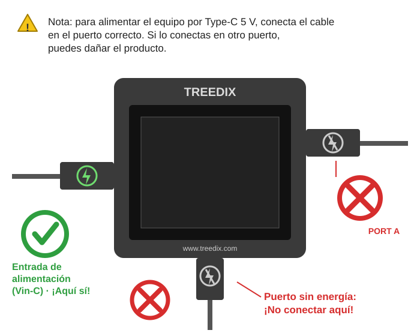

# Tester de cables USB Treedix

Cómo comprobar si un cable USB funciona, qué tan rápido transmite datos y cuánta energía soporta.

---

## Para qué sirve

El **tester de cables USB Treedix** es un aparato con pantalla a color donde se conecta un cable por cada extremo. Con eso te dice, en una sola prueba:

- **Qué puede hacer el cable:** velocidad de datos (USB 2.0, 3.2, 4.0, Thunderbolt) y potencia de carga.
- **Si el cable está roto por dentro:** revisa cada hilo interno.
- **Qué tanta resistencia tiene el cable:** un cable en mal estado "frena" la energía.
- **Qué dice el chip del cable (eMarker):** solo en cables Type-C.

> 💡 **Para qué te sirve en la práctica:** saber si un cable que "no carga" o "no transmite" está dañado, o si simplemente no es el adecuado (por ejemplo, un cable lento usado donde se necesita uno rápido).

## Datos del equipo

| Característica | Valor |
|---|---|
| Pantalla | TFT a color de 2,4" con luz de fondo |
| Alimentación | Una **batería AAA** o un cable **Type-C de 5 V** |
| Tamaño | 75 × 65 × 15 mm |
| Duración con batería | Aproximadamente **2 horas** de uso |
| Temperatura de uso | −10 °C a 40 °C |

## Conoce el tester

Las partes que vas a usar:

| Parte | Qué es |
|---|---|
| **Tecla de cambio de función** | Botón del lado izquierdo. Cada pulsación cambia de prueba. |
| **Interruptor de alimentación** | Elige de dónde se alimenta: **[Battery]** (batería) o **[Vin-C]** (cable Type-C). |
| **Entrada Type-C 5 V** | Para alimentar el tester con un cargador o cable USB-C. |
| **PORT A** (lado derecho) | Entradas para un extremo del cable: **Type-C** y **Type-A**. |
| **PORT B** (abajo) | Entradas para el otro extremo: **Lightning, Mini-B, Type-C, Micro-B 3.0 y Micro-B 2.0**. |

### Los conectores más comunes

| Nombre | Dónde lo ves normalmente |
|---|---|
| **Type-A** | El USB rectangular y plano de toda la vida (computadores, cargadores). |
| **Type-C** | Ovalado y reversible, sin lado "correcto" (celulares nuevos, portátiles). |
| **Micro-B** | Trapezoidal y pequeño (celulares y accesorios antiguos). El **3.0** es más ancho que el **2.0**. |
| **Mini-B** | Pequeño y trapezoidal, más grueso que el Micro-B (cámaras, discos duros antiguos). |
| **Lightning** | El de los iPhone y iPad. |

## Antes de usarlo

> ⚠️ **Para no dañar el tester ni los cables**
>
> - **Primer uso:** el tester trae una **película de plástico sobre la batería**. Retírala antes de usarlo; si no, no funcionará bien.
> - **Conecta solo un cable a la vez.** Nunca pruebes dos cables al mismo tiempo.
> - **No conectes PORT A ni PORT B a un computador, cargador u otro equipo.** Solo van los dos extremos del cable que vas a probar. La pantalla lo recuerda: *"Don't Connect To Device"*.
> - Usa solo la alimentación indicada: batería AAA o Type-C de **5 V**. Evita fuentes de voltaje alto o inestables.
> - Úsalo solo para **probar cables de datos USB**, nada más.
> - Aléjalo de humedad, agua, polvo, sol directo y calor.

### Cómo encenderlo

1. **Con batería:** pon una pila AAA (con la película plástica ya retirada) y deja el interruptor en **[Battery]**.
2. **Con cable Type-C:** conéctalo a la entrada Type-C 5 V y pasa el interruptor a **[Vin-C]**.
3. La pantalla enciende y muestra *"Please Connect The Cable"* (conecta el cable).

> ⚠️ **Cuidado: conecta la alimentación Type-C en el puerto correcto**
>
> El tester tiene varios puertos Type-C y **solo uno recibe energía**: la entrada de alimentación (Vin-C), en el **lado izquierdo**. Los puertos de **PORT A** (derecha) y **PORT B** (abajo) **no son de alimentación**: ahí solo se conecta el cable que vas a probar. Si conectas el cargador en otro puerto, **puedes dañar el equipo**.

  

> 💡 **Conviene saber**
>
> - El **indicador de batería** solo aparece cuando usas pila.
> - Sin usarlo, la pantalla se **oscurece a 1 minuto** y entra en **reposo a los 2 minutos**.
> - Si no lo vas a usar por mucho tiempo, **apágalo** y retira la pila.
> - Si la pila está baja, **cámbiala**: con poca batería las mediciones salen mal.

## Cómo hacer una prueba (paso a paso)

1. **Enciende** el tester.
2. **Conecta un extremo** del cable en **PORT A** (Type-A o Type-C).
3. **Conecta el otro extremo** en **PORT B** (el que coincida con tu cable).
4. **Pulsa la tecla de función** (izquierda) para pasar de una prueba a otra y leer cada resultado.
5. **Desconecta el cable** al terminar.

Hay **4 pruebas**. Cada pulsación de la tecla de función pasa a la siguiente:

| Orden | Nombre en pantalla | Qué te dice |
|:---:|---|---|
| 1 | **Basic functions** | Velocidad de datos y potencia de carga |
| 2 | **USB Cable Checker** | Si cada hilo interno funciona |
| 3 | **Resistance Test** | Resistencia del cable |
| 4 | **USB-C eMarker** | Información del chip del cable Type-C |

> 💡 **Mensaje en pantalla sin cable:** *"Please Connect The Cable"* = el tester espera un cable. Todavía no está probando nada.

---

## Prueba 1: Funciones básicas (Basic functions)

La más útil para empezar. Indica **qué velocidad de datos** y **cuánta potencia de carga** soporta el cable.

La pantalla muestra una lista de funciones. Cada una tiene un indicador:

- 🟢 **Punto verde:** el cable **sí soporta** esa función.
- ❌ **Cruz roja:** el cable **no soporta** esa función.

### Transmisión de datos (Data Transmission)

| En pantalla | Significado | Velocidad máxima |
|---|---|---|
| **USB 2.0** | Datos básicos | 480 Mbps |
| **USB 3.2** | Datos rápidos | 20 Gbps (mucho más rápido que USB 2.0) |
| **USB 4.0** | Datos muy rápidos | 40 Gbps |
| **TBT3 / TBT4 / TBT5** | Compatible con Thunderbolt 3, 4 y 5 | Según versión |

### Transmisión de energía (Power Transmission)

| En pantalla | Significado | Potencia máxima |
|---|---|---|
| **PD <65W** | Carga normal | Menos de 65 W |
| **PD 2.0/3.0** | Carga rápida | Hasta 100 W |
| **PD 3.1** | Carga muy alta (portátiles potentes) | Hasta 240 W |

> 💡 **Ejemplo:** un cable Type-C con todos los puntos en verde soporta datos **USB 4.0 / TBT5** y carga de alta potencia **PD 3.1**. Un cable con cruces rojas en varias líneas es un cable básico: sirve para cargar o para datos simples, pero no para tareas exigentes.

> 💡 **Un cable puede soportar una cosa y la otra no.** Por ejemplo, un cable puede cargar bien pero transmitir datos lento. Por eso se revisan las dos listas.

---

## Prueba 2: Cable interno (USB Cable Checker)

Revisa **cada hilo (conductor) dentro del cable**. Sirve para encontrar cables **cortados o con un hilo roto** aunque por fuera se vean bien.

La pantalla muestra el conector del cable con una fila de puntos o pines:

| Color | Significado |
|---|---|
| 🟢 **Verde** | Ese hilo está conectado de un extremo al otro. |
| 🔴 **Rojo** | Ese hilo **no está conectado** (abierto). |

> ⚠️ **Rojo no siempre significa cable dañado.** Muchos cables están hechos a propósito sin algunos hilos (por ejemplo, un cable solo para cargar). Lo importante es **qué pines necesitas según para qué vas a usar el cable**. Mira las tablas siguientes.

### Primero: ¿para qué vas a usar el cable?

| Uso | Qué necesita el cable |
|---|---|
| 🔋 **Solo carga** | Hilos de **energía** (VBUS y GND). |
| 💾 **Datos** (copiar archivos, conectar equipos) | Hilos de energía **y** de **datos** (D+ y D−). |
| 🔋💾 **Carga y datos** | Todos los anteriores. Es el cable más completo. |

### Cables Type-A, Micro-B y Mini-B

| Pin | Para qué sirve | Carga | Datos | Si sale 🔴 |
|---|---|:---:|:---:|---|
| **VBUS** | Lleva la energía (+5 V) | ✅ Necesario | ✅ Necesario | Cable **dañado**. No sirve para nada. |
| **GND** | Retorno de la energía (tierra) | ✅ Necesario | ✅ Necesario | Cable **dañado**. No sirve para nada. |
| **D+** | Datos | ➖ No se usa | ✅ Necesario | Si es cable de datos: **dañado**. Si es de carga: es normal. |
| **D−** | Datos | ➖ No se usa | ✅ Necesario | Si es cable de datos: **dañado**. Si es de carga: es normal. |
| **ID** | Solo para funciones especiales (OTG) | ➖ No se usa | ➖ No se usa | **Normal.** Ignóralo. |

**Cómo leer el resultado:**

| Lo que ves | Conclusión |
|---|---|
| VBUS, GND, D+ y D− en 🟢 | ✅ Cable de **carga y datos**. Sirve para los dos usos. |
| VBUS y GND en 🟢, D+ y D− en 🔴 | 🔋 Cable **solo de carga**. No sirve para transmitir datos. |
| VBUS o GND en 🔴 | ⛔ Cable **dañado**. No lo uses. |
| Solo D+ o solo D− en 🔴 (el otro en 🟢) | ⛔ **Dañado.** No sirve para datos y puede dar fallas. |
| ID en 🔴 y todo lo demás en 🟢 | ✅ Normal. El cable está bien. |

### Cables Type-C

El Type-C tiene muchos más pines, pero **no todos tienen que estar en verde**. Cada tipo de cable usa los que le corresponden:

| Pines | Para qué sirven | Carga | Datos USB 2.0 | Datos rápidos (USB 3.2 / 4.0) |
|---|---|:---:|:---:|:---:|
| **VBUS** y **GND** | Energía | ✅ | ✅ | ✅ |
| **CC1 / CC2** | "Conversan" con el equipo para negociar la carga | ✅ | ✅ | ✅ |
| **D+ / D−** | Datos básicos (USB 2.0) | ➖ | ✅ | ✅ |
| **TX1, TX2, RX1, RX2** | Datos de alta velocidad | ➖ | ➖ | ✅ |
| **SBU1 / SBU2** | Señales especiales (video, audio) | ➖ | ➖ | Opcional |

**Cómo leer el resultado:**

| Lo que ves | Conclusión |
|---|---|
| Casi todos 🟢 | ✅ Cable **completo**: carga rápida y datos de alta velocidad. |
| VBUS, GND, CC y D+/D− en 🟢; TX, RX y SBU en 🔴 | 🔋💾 Cable de **carga y datos básicos** (USB 2.0). Es normal que no tenga los demás hilos. |
| VBUS y GND en 🟢 pero CC o D+/D− en 🔴 | ⚠️ Cable **solo de carga** o de calidad básica. Puede cargar lento o no cargar con algunos equipos. |
| VBUS o GND en 🔴 | ⛔ Cable **dañado**. No lo uses. |
| TX / RX en 🔴 en un cable que debería ser de alta velocidad | ⛔ Cable **dañado** para datos rápidos, aunque cargue bien. |

> 💡 **Es normal en Type-C:** algunos pines aparecen en rojo aunque el cable esté perfecto, por ejemplo uno de los dos **CC** o uno de los dos juegos de **D+/D−**, porque los cables solo conectan uno de cada uno. Por eso lo mejor es **comparar con un cable bueno del mismo tipo** que ya sepas que funciona.

### ¿Qué hacer si ves un rojo importante?

1. **Mueve suavemente** el cable cerca de los conectores y mira si el color cambia. Si cambia, hay un **falso contacto**.
2. **Reinserta** los dos extremos y repite la prueba.
3. Si el rojo sigue en un pin que **sí necesitas** (según las tablas), el cable está dañado: **sepáralo y no lo uses**.

---

## Prueba 3: Resistencia interna (Resistance Test)

Mide cuánto "frena" el cable el paso de la energía. **Mientras más baja la resistencia, mejor el cable.** Un cable con resistencia muy alta calienta, carga lento o no alimenta bien un equipo.

### Qué ves en pantalla

| Línea | Qué mide | Cómo leerla |
|---|---|---|
| **VBUS - GND** | Resistencia del cable de energía, en miliohmios (**mΩ**) | Un número **bajo** es bueno. Ejemplo: `92 mΩ`. |
| **SHELL - GND** | Si la carcasa metálica del conector está conectada a tierra | **SHORT** = conectada a tierra. **OPEN** = no conectada. |
| **CC1 RES / CC2 RES** | Resistencias internas del cable Type-C | Se muestra **UP** (pull-up) o **DN** (pull-down) con su valor, por ejemplo `DN 1K`. **OPEN** = no hay resistencia en esa línea. |

> 💡 **Ejemplo real del manual:** `VBUS - GND: 92 mΩ`. Es la resistencia **total** de los cables conectados (los dos extremos juntos).

### Cosas importantes

> ⚠️ **Para que el resultado sea confiable**
>
> 1. La medición incluye la resistencia del contacto del conector. Si el contacto es bueno, el error es de aproximadamente **±10 %**. **Asegura que los conectores queden bien insertados.**
> 2. Con **batería baja** las mediciones salen mal. Cambia la pila o usa alimentación Type-C.
> 3. **Solo** los cables **Type-A a Type-C** y **Type-C a Type-C** tienen resistencias CC (pull-up / pull-down). En otros cables es normal que salga **OPEN**.
> 4. **Cables Lightning:** por el chip que llevan dentro, los resultados de esta prueba **presentan errores**. No te fíes de ellos.

---

## Prueba 4: Lectura del eMarker Type-C (USB-C eMarker)

Los cables Type-C buenos traen un **chip interno llamado eMarker** que guarda sus características (velocidad, potencia, fabricante). Esta prueba lo lee.

- **Si hay chip:** muestra su información.
- **Si no hay chip:** muestra *"No se detectó ningún chip eMarker"*. No siempre es un problema: los cables Type-C simples o de carga básica no lo tienen.

> ⚠️ **Esta prueba solo funciona con cables Type-C pasivos** (los normales).

### Qué información muestra

| En pantalla | Qué significa |
|---|---|
| **Type** | Tipo de cable (**Passive** = normal, sin electrónica activa) |
| **Latency** | Retraso de la señal. Depende de la longitud del cable. Ejemplo: `10ns (<1m)` = cable de menos de 1 metro. |
| **Power / Supply** | Voltaje, corriente y potencia máximos que admite. Ejemplo: `50V, 5A (240W)`. **EPR** = admite potencias altas (carga extendida). |
| **Speed** | Velocidad máxima y protocolo. Ejemplo: `USB 4 Gen3 · 40Gbps`, `USB 2.0 · 480Mbps`. |
| **Vendor** | Número del fabricante del cable (referencia del chip). |
| **VER** | **HW** = versión del hardware. **FW** = versión del software interno. |

### Ejemplos del manual

| Cable | Velocidad | Potencia |
|---|---|---|
| **TBT4** | 40 Gbps | 240 W (EPR) |
| **TBT5** | 80 Gbps | 240 W (EPR) |
| **USB 2.0** | 480 Mbps | 240 W (EPR) |

> 💡 Un cable **USB 2.0** puede soportar mucha potencia pero **poca velocidad de datos**. Fíjate siempre en las dos cosas.

---

## ¿Qué hacer según el resultado?

| Resultado | Qué significa | Qué hacer |
|---|---|---|
| Datos y potencia en 🟢, todo verde, resistencia baja | Cable en buen estado | ✅ Úsalo con confianza. |
| Pin importante en 🔴 en la Prueba 2 (VBUS, GND o los de datos si lo necesitas para datos) | Cable con hilo cortado | ⛔ **No usarlo.** Sepáralo y avisa a tu responsable. |
| Solo D+ y D− en 🔴, pero lo usas solo para cargar | Cable solo de carga | ✅ Sirve para cargar, **no** para datos. Márcalo para no confundirlo. |
| Resistencia muy alta (Prueba 3) | El cable calienta o carga lento | ⚠️ Evita usarlo para cargar equipos importantes. Repite la prueba antes de descartarlo. |
| Faltan velocidades o potencia (Prueba 1) | Es un cable básico, pero funciona | ⚠️ Úsalo solo donde no se necesite alta velocidad o carga rápida. |
| Resultados raros o cambian cada vez | Falso contacto o batería baja | 🔁 Reinserta los conectores, cambia la pila y repite la prueba. |

> 💡 **Antes de descartar un cable:** repite la prueba 2 veces y revisa que los conectores estén bien insertados y que la pila no esté baja.

## Uso y cuidados

- **No** conectes el tester a computadores ni equipos: solo cables.
- **Un cable a la vez.**
- Si no vas a usarlo por mucho tiempo, **apágalo y retira la pila**.
- Cambia la pila cuando el indicador de batería esté bajo.
- Guárdalo seco, sin humedad, sol directo ni calor.
- **Pilas gastadas y equipo electrónico:** deséchalos siguiendo la normativa local, no con la basura común.

---

Takub · Guías de procesos en producción · Basada en el manual del fabricante (Treedix, tester de cables USB)
