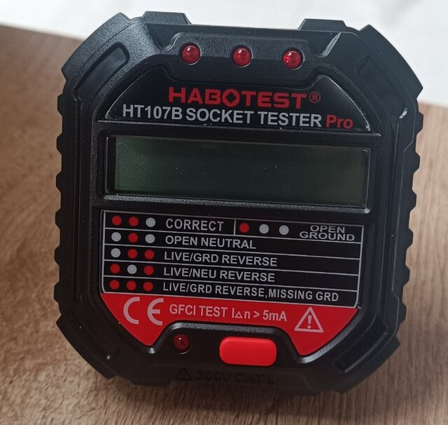
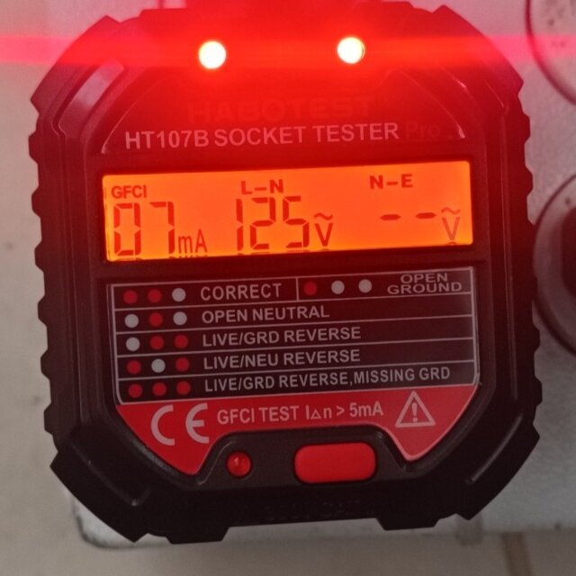

# Tester de tomacorrientes HT107B

Cómo comprobar que un tomacorriente está bien cableado y que su protección diferencial funciona.

---

## Para qué sirve

El **Habotest Socket Tester Pro HT107B** se enchufa en un tomacorriente de tres huecos (fase, neutro y tierra) y permite:

- **Detectar errores de cableado** con las 3 luces indicadoras.
- **Medir el voltaje de fase** (L-N), de 90 a 250 V.
- **Medir el voltaje de fuga** (N-E), de 0 a 99 V.
- **Probar la protección diferencial** (RCD o GFCI) con el botón RCD.

## Pantalla

| Indicador | Qué muestra |
|---|---|
| **RCD / GFCI** | Corriente de disparo de la protección (p. ej. 30 mA) |
| **L-N** | Voltaje entre fase y neutro (p. ej. 220 V) |
| **N-E** | Voltaje de fuga entre neutro y tierra (p. ej. 00 V) |

  

1. **3 luces rojas** (arriba): indican el estado del cableado.
2. **Pantalla:** corriente RCD/GFCI, voltaje L-N y voltaje N-E.
3. **Tabla de errores** impresa en el equipo, para comparar con las luces.
4. **Botón RCD** (rojo, abajo): inicia la prueba de la protección diferencial.

## Antes de usarlo

> ⚠️ **Seguridad: para evitar descargas eléctricas y lesiones**
>
> - Revisa el tester. Si tiene **algún daño, no lo uses** y envíalo a reparar.
> - **Comprueba que funciona:** enchúfalo primero en un tomacorriente que sepas que está bien y verifica que da el resultado correcto.
> - La prueba RCD solo es válida si el tomacorriente tiene el cableado correcto.
> - Si detectas un cableado incorrecto, **no lo repares tú**: llama a un electricista profesional.

## Cómo probar un tomacorriente

1. **Enchufa el tester** en el tomacorriente estándar de tres huecos.
2. **Mira las 3 luces** y compáralas con la tabla de errores.
3. **Lee la pantalla:** voltaje de fase (L-N) y de fuga (N-E).
4. **Retira el tester.** Si el cableado es incorrecto, avisa a un electricista profesional.

> 💡 **Nota:** si la conexión del tomacorriente no es correcta, el voltaje de fuga no se puede medir.

## Tabla de errores

🔴 = luz encendida · ⚪ = luz apagada

| Resultado | Luz 1 | Luz 2 | Luz 3 | ¿Se puede usar? |
|---|:---:|:---:|:---:|---|
| **Correcto** | 🔴 | 🔴 | ⚪ | ✅ **Sí** |
| **Fase / neutro invertidos** (live/neu reverse) | 🔴 | ⚪ | 🔴 | ⚠️ **Solo con precaución** |
| **Tierra abierta** (open ground) | 🔴 | ⚪ | ⚪ | ⚠️ **Solo con precaución** |
| **Neutro abierto** (open neutral) | ⚪ | 🔴 | ⚪ | ⛔ **No** |
| **Fase abierta** (open live) | ⚪ | ⚪ | ⚪ | ⛔ **No** |
| **Fase / tierra invertidas** (live/grd reverse) | ⚪ | 🔴 | 🔴 | ⛔ **No** |
| **Fase / tierra invertidas y sin tierra** (live/grd reverse, missing grd) | 🔴 | 🔴 | 🔴 | ⛔ **No** |

**Ejemplo real:** a 125 V la pantalla muestra **GFCI** (en 220 V muestra **RCD**). Aquí hay solo 2 luces encendidas, la 1 y la 3, que según la tabla es **fase / neutro invertidos**. Además el voltaje N-E aparece como `--` porque, con el cableado incorrecto, no se puede medir.

  

> 💡 **Conviene saber**
>
> - **Fase/tierra invertidas y sin tierra:** la fase y la tierra están cruzadas y además el cable de tierra no está conectado.
> - El tester **no distingue** entre el neutro y la tierra si están cambiados entre sí.

### Qué significa cada resultado y qué hacer

#### ✅ Correcto
El cableado está bien. **Se puede usar** y se puede hacer la prueba del diferencial.

> El tester no detecta todo: no distingue un neutro y una tierra cambiados entre sí. «Correcto» es buena señal, pero no sustituye una revisión eléctrica.

#### ⚠️ Solo con precaución

Los equipos funcionan, pero **no están bien protegidos**. Úsalo solo de forma temporal, mientras se programa la reparación.

| Resultado | Qué pasa | Cuidados |
|---|---|---|
| **Fase / neutro invertidos** | Los equipos funcionan con normalidad, pero al apagarlos con su interruptor **siguen con voltaje por dentro**. | **Desenchufa** el equipo antes de abrirlo, limpiarlo o cambiar piezas; no basta con apagarlo. No conectes equipos que vayas a manipular con frecuencia. |
| **Tierra abierta** | Los equipos funcionan, pero **sin conexión a tierra**. Si hay una falla, la carcasa metálica puede quedar con voltaje, y la protección RCD/GFCI no se puede probar. | No toques partes metálicas del equipo con las manos mojadas. Evita equipos con carcasa metálica (PCs, impresoras, pantallas) y no uses adaptadores «de 3 a 2 patas». |

#### ⛔ No usar

**No conectes ningún equipo.** Hay riesgo de descarga o de daño al equipo.

| Resultado | Qué pasa |
|---|---|
| **Neutro abierto** | El equipo no funciona bien o no enciende y puede quedar con voltaje de red aunque parezca apagado. |
| **Fase abierta** | No llega fase. Puede ser un cable roto o un breaker apagado; el tester muestra lo mismo si **no hay energía**. |
| **Fase / tierra invertidas** | La carcasa metálica de los equipos queda conectada a la fase, es decir, **con voltaje**. Es muy peligroso. |
| **Fase / tierra invertidas y sin tierra** | Combina el caso anterior con la falta de tierra. Es muy peligroso. |

En estos casos:

1. **Desconecta el tester y no enchufes nada** en ese tomacorriente.
2. **Márcalo** con cinta o un letrero «NO USAR».
3. **Avisa** a tu responsable y llama a un **electricista profesional**. No intentes repararlo tú.
4. Si el resultado es «Fase abierta», revisa antes que el breaker esté activo y que el tester funcione (pruébalo en un tomacorriente que sepas que está bien).

> ⚠️ **Cuidados generales con cualquier error**
>
> - No uses regletas ni extensiones para «arreglar» el problema: el error sigue ahí.
> - No muevas los cables del tomacorriente tú mismo.
> - Si dudas del resultado, repite la prueba y trata el tomacorriente como **no seguro** hasta que lo revise un electricista.

## Prueba de la protección diferencial (RCD / GFCI)

Comprueba que el interruptor diferencial realmente corta la corriente.

> ⚠️ **Antes de empezar**
>
> - La prueba **corta la electricidad** de esa línea. Apaga o desconecta los equipos conectados para evitar daños.
> - En lugares públicos o ajenos, **pide autorización** antes de probar.
> - Usa solo un tomacorriente con el cableado correcto (resultado «Correcto»).

1. **Enchufa el tester** en un tomacorriente con cableado correcto. La pantalla muestra la corriente de disparo (RCD o GFCI).
2. **Mantén pulsado el botón `RCD` más de 2 segundos.**
3. **Interpreta el resultado:**
   - ✅ **Salta el diferencial:** la protección funciona con normalidad.
   - ❌ **No salta:** la protección está averiada. Llama a un electricista profesional.

> ⚠️ No pulses el botón RCD por error durante el uso normal: dispararía la protección y causaría cortes innecesarios.

## Especificaciones técnicas

| Característica | Valor |
|---|---|
| Voltaje de operación | 90 – 250 V · 45 – 65 Hz |
| Voltaje de fase (L-N) | 90 – 250 V · precisión ±(2,0 % + 2) |
| Voltaje de fuga (N-E) | 0 – 99 V · precisión ±(2,0 % + 2) |
| Prueba RCD | > 30 mA · trabaja a 220 V ± 20 V |
| Prueba GFCI | > 5 mA · trabaja a 110 V ± 20 V |
| Temperatura de operación | 0 °C a 40 °C |
| Humedad de operación | 20 % a 75 % HR |
| Temperatura de almacenamiento | −10 °C a 50 °C |
| Humedad de almacenamiento | 20 % a 80 % HR |
| Altitud máxima | ≤ 2000 m |
| Categoría de seguridad | CAT. II 300 V (IEC 61010-1) |

Las funciones **RCD y GFCI no coexisten**.

## Uso y cuidados

- **Tiempo máximo de prueba: 5 minutos** seguidos.
- **Limpieza:** con un paño húmedo, sin productos químicos.
- Después de limpiarlo, **déjalo secar por completo** antes de volver a usarlo.
- Guárdalo dentro del rango de temperatura y humedad indicado.

---

Takub · Guías de procesos en producción · Basada en el manual del fabricante (Habotest HT107B)
